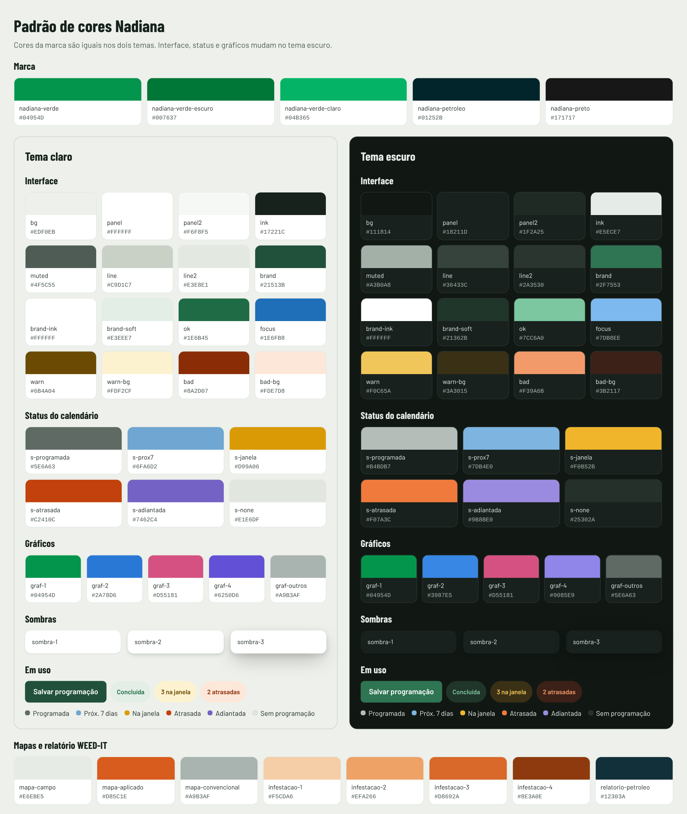

# Nadiana · base de design

Cores, fontes, logos, componentes, ícones, gráficos e PDF de todos os projetos da Nadiana Agronegócios.

- **Endereço publicado:** https://fabianodsf12-beep.github.io/nadiana-design/v1/
- **Vitrine** (tudo funcionando, nos dois temas): https://fabianodsf12-beep.github.io/nadiana-design/v1/vitrine.html
- **Regras da marca:** [`v1/README.md`](v1/README.md)
- **Design System no claude.ai:** https://claude.ai/artifact/RJR1bMDsYXqaLHa9YU91JV



## Como um projeto usa a base

Os projetos apontam para o endereço publicado, sem copiar arquivos:

```html
<link rel="stylesheet" href="https://fabianodsf12-beep.github.io/nadiana-design/v1/tokens.css">
<link rel="stylesheet" href="https://fabianodsf12-beep.github.io/nadiana-design/v1/componentes.css">
<script src="https://fabianodsf12-beep.github.io/nadiana-design/v1/icones.js"></script>
<script src="https://fabianodsf12-beep.github.io/nadiana-design/v1/nadiana.js" defer></script>
```

Projeto novo: comece do [`v1/modelo.html`](v1/modelo.html) e copie [`modelos/CLAUDE.md`](modelos/CLAUDE.md) para a raiz do projeto, para o Claude seguir a base lá.

## Versões

- Tudo o que está em `v1/` vale para todos os projetos ao mesmo tempo. Ajustes que não quebram nada (uma cor mais acertada, um componente novo, um ícone a mais) entram direto em `v1/`, e todos os projetos recebem.
- Uma mudança que obrigaria os projetos a mexer no código (renomear uma classe, tirar um componente) vai para uma pasta nova, `v2/`. Os projetos continuam em `v1/` até alguém trocá-los de propósito.

## Como mudar a base

- **Uma cor, espaço, canto ou sombra:** mude no Design System do claude.ai (ou direto em `v1/tokens.json`), copie o `tokens.json` para `v1/` e rode `python3 v1/gerar_tokens.py`. Ele refaz `tokens.css` e `tokens.js`; nunca edite esses dois à mão.
- **Um ícone:** ponha o nome em `v1/gerar_icones.py` e rode como diz o topo do arquivo.
- **Um componente:** em `v1/componentes.css` (e `v1/nadiana.js`, se tiver comportamento), sempre com prefixo `nd-` e só com variáveis de `tokens.css`. Mostre o componente novo na vitrine e descreva no `v1/README.md`.
- Abra a vitrine nos dois temas antes de publicar.

## Publicação

O GitHub Pages publica este repositório a partir do branch `main`, pasta raiz. Cada mudança no `main` chega ao endereço publicado em um ou dois minutos.
