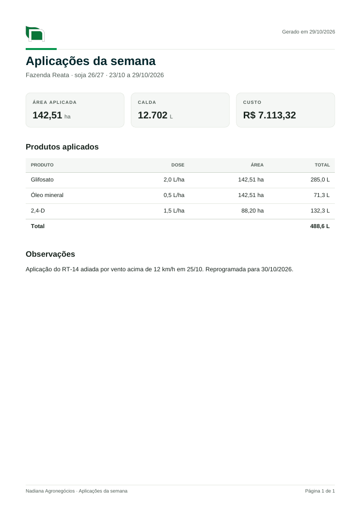

# Nadiana: base de design

Regras visuais de todos os projetos da Nadiana Agronegócios: aplicativos de campo (Painel de aplicações, Lançamentos), relatórios (como o de aplicação localizada WEED-IT) e apresentações. Todo projeto novo parte daqui.

A mesma base está publicada como Design System **Nadiana** no claude.ai: https://claude.ai/artifact/RJR1bMDsYXqaLHa9YU91JV. O `tokens.json` desta pasta é o mesmo de lá; os componentes também estão lá, cada um com guia e prévia ao vivo.

## O que tem nesta pasta

| Arquivo | Para quê |
| --- | --- |
| `tokens.json` | Fonte única de cores, textos, espaços, cantos e sombras. |
| `tokens.css`, `tokens.js` | Os tokens como variáveis CSS (`var(--brand)`) e como objeto JavaScript (`NadianaTokens.light`). Gerados: não edite à mão. |
| `gerar_tokens.py` | Gera `tokens.css` e `tokens.js` a partir do `tokens.json`. |
| `componentes.css` | Base da página e componentes prontos, todos com prefixo `nd-`. |
| `nadiana.js` | Comportamento dos componentes: aviso rápido, tema, abas, seletor, filtros, folha de baixo, formatos brasileiros. |
| `icones.js`, `gerar_icones.py` | 58 ícones Lucide para os apps, embutidos (funcionam sem internet). |
| `graficos.js` | Padrão dos gráficos Chart.js. |
| `pdf.js` | Padrão dos relatórios em PDF (jsPDF). |
| `vitrine.html` | Mostra tudo funcionando, nos dois temas. Abra para conferir. |
| `modelo.html` | Página de partida para um app novo. |
| `padrao-de-cores.png`, `exemplo-pdf.png` | Imagens de referência das cores e do relatório. |
| `logos/` | Logo vertical e símbolo, em SVG (telas e impressão) e PNG (PDF), com fundo transparente. |
| `fonts/` | Barlow e Barlow Condensed em woff2. |

## Como usar num projeto novo

A base fica publicada em **https://fabianodsf12-beep.github.io/nadiana-design/v1/**. Os projetos apontam para esse endereço, sem copiar arquivos: quando a base muda, todos recebem.

1. Na página, carregue nesta ordem:
   ```html
   <link rel="stylesheet" href="https://fabianodsf12-beep.github.io/nadiana-design/v1/tokens.css">
   <link rel="stylesheet" href="https://fabianodsf12-beep.github.io/nadiana-design/v1/componentes.css">
   <script src="https://fabianodsf12-beep.github.io/nadiana-design/v1/icones.js"></script>
   <script src="https://fabianodsf12-beep.github.io/nadiana-design/v1/nadiana.js" defer></script>
   ```
   Com gráficos, acrescente o Chart.js 4.4.1 e `https://fabianodsf12-beep.github.io/nadiana-design/v1/graficos.js`. Com PDF, o jsPDF 2.5.1, o autoTable 3.8.2, `https://fabianodsf12-beep.github.io/nadiana-design/v1/tokens.js` e `https://fabianodsf12-beep.github.io/nadiana-design/v1/pdf.js`. As instruções de uso estão no topo de cada arquivo.
2. Logos: `https://fabianodsf12-beep.github.io/nadiana-design/v1/logos/nadiana-simbolo.svg` e `nadiana-logo-vertical.svg` (os PNGs com o mesmo nome são para o PDF).
3. Comece do `modelo.html` (troque os caminhos relativos pelo endereço acima).
4. Copie `modelos/CLAUDE.md` do repositório nadiana-design para a raiz do projeto novo, para o Claude seguir estas regras lá.

Numa página publicada como Artifact do Claude, arquivos externos não carregam: cole o conteúdo dos arquivos dentro de `<style>` e `<script>` e troque as fontes locais pelo Google Fonts (`family=Barlow:wght@400;500;600&family=Barlow+Condensed:wght@500;600;700`).

Para mudar uma cor: altere no Design System do claude.ai (ou no `tokens.json`), copie o `tokens.json` para `v1/` e rode `python3 v1/gerar_tokens.py`.

## Marca


- O nome da empresa é **Nadiana Agronegócios**.
- **Logo vertical** (`logos/nadiana-logo-vertical.svg`): folha com o "n", NADIANA em `nadiana-petroleo` e AGRONEGÓCIOS em verde. Use na capa, na tela inicial, na navegação lateral e em impressos. O nome é escuro: em fundo escuro (`nadiana-petroleo`, tema escuro), o logo vertical vai sempre na placa branca `.nd-logo`.
- **Símbolo** (`logos/nadiana-simbolo.svg`): só a folha com o "n". Use no cabeçalho dos apps (`.nd-simbolo`), no cabeçalho do PDF, como ícone de app e favicon, a partir de 24px de altura. Funciona sem placa em fundo claro e escuro.
- Não há versão horizontal: no cabeçalho, o símbolo vem ao lado do nome do app.
- Os SVGs têm fundo transparente e podem ser ampliados para impressão, placa e fachada. Os PNGs com o mesmo nome existem só porque o gerador de PDF não lê SVG.
- O "n" branco tem um contorno cinza bem fino, que faz parte do desenho: é ele que separa o "n" de um fundo branco.
- Respiro em volta de pelo menos metade da altura do símbolo. Não recolora, não estique, sem sombra nem contorno extra.
- `logos/nadiana-logo.png` é o logo horizontal antigo: fica só para não quebrar páginas antigas. Não use.

## Estrutura das telas

- **Cabeçalho claro** (`.nd-topo`): fundo `panel`, símbolo (`.nd-simbolo`) à esquerda, nome do app e subtítulo, ações à direita. O verde não pinta o cabeçalho: ele fica para o que se toca (botão principal, item ativo, número de destaque).
- **Faixa de marca** (`.nd-faixa`): fundo `nadiana-petroleo`, só em capa, tela inicial e abertura de relatório.
- **Navegação** (`.nd-app` + `.nd-nav`): barra embaixo no celular (até 5 itens, ícone e nome) e lateral a partir de 900px, com o logo no topo. A página atual leva `aria-current="page"`.
- A ação principal da tela pode ir no botão flutuante `.nd-fab` no celular.

## Cores

Use sempre a variável, nunca o código da cor solto no CSS.


- **Identidade.** `nadiana-verde` em faixas, blocos de capa, ícones e números grandes. Texto verde sobre branco: `nadiana-verde-escuro`. Sobre fundo escuro: `nadiana-verde-claro`. `nadiana-petroleo` é o escuro da marca, para títulos de capa e faixas.
- **Interface.** Fundo `bg`, cartões `panel`, campos e linhas alternadas `panel2`. Texto `ink`; rótulos, unidades e apoio `muted`. Bordas `line`, divisões leves `line2`.
- **Ação.** Botão principal e item ativo em `brand` com texto `brand-ink`. Destaque suave (chips, item ativo da navegação) em `brand-soft`.
- **Situação.** Aviso: `warn` sobre `warn-bg`. Erro ou atraso: `bad` sobre `bad-bg`. Concluído: `ok`. Toda situação leva uma palavra ou ícone, nunca só a cor.
- **Calendário de aplicações.** `s-programada`, `s-prox7`, `s-janela`, `s-atrasada`, `s-adiantada`, `s-none`, sempre com legenda visível.
- **Gráficos.** `graf-1` (verde da marca), `graf-2` (azul), `graf-3` (magenta), `graf-4` (violeta), sempre nessa ordem; `graf-outros` (cinza) para "Outros" e para o convencional. Testadas para daltonismo e contraste nos dois temas.
- Texto branco sobre `nadiana-verde` só a partir de 24px (19px em negrito). Botão verde usa `brand` ou `nadiana-verde-escuro`.
- Aplicativos têm tema claro e escuro; relatórios em PDF só o claro.

## Tipografia

- **Barlow** para texto (`--font-body`), **Barlow Condensed** para títulos e números (`--font-display`).
- Classes prontas: `.nd-titulo-pagina` (28px), `.nd-subtitulo` (18px), `.nd-numero-destaque` (30px), `.nd-corpo-destaque` (17px), `.nd-corpo` (16px), `.nd-corpo-pequeno` (14px), `.nd-rotulo` (13px, caixa alta), `.nd-legenda` (12,5px).
- Números que se comparam em coluna: `font-variant-numeric: tabular-nums` (ou a classe `.nd-num`).

## Espaço, cantos, sombras e movimento

- Espaços: `--space-1` 4px, `--space-2` 8px, `--space-3` 12px, `--space-3_5` 14px, `--space-4` 16px, `--space-5` 20px, `--space-6` 24px.
- Margem lateral mínima `space-4`. Cartões com padding `space-4` (`space-6` nos grandes) e `space-5` entre eles. Linhas e campos: `space-3` na vertical, `space-3_5` na horizontal.
- Cantos: `radius-md` (8px) em botões, `radius-lg` (10px) em campos, `radius-xl`/`radius-2xl` (12/14px) em cartões, `radius-pill` em chips e etiquetas, `radius-xs` em barras de gráfico.
- Sombras: `sombra-1` em cartões e cabeçalho, `sombra-2` ao passar o mouse e em menus, `sombra-3` no que fica por cima da página (folha, janela, aviso rápido, navegação do celular). Sombra é sempre preta com transparência; não use sombra colorida.
- Movimento: `--dur-rapida` 120ms (botões), `--dur-media` 200ms (abas, seletor, cartões), `--dur-lenta` 320ms (folha, aviso) e `--curva`. Quem pede menos movimento no aparelho não vê animação.
- Alvos de toque com pelo menos 44px de altura; campos de formulário 48px.

## Componentes (`componentes.css` + `nadiana.js`)

| Classe | O que é |
| --- | --- |
| `.nd-wrap` (`.largo`, `.estreito`) | Coluna central com margem lateral segura (860, 1440 ou 640px). |
| `.nd-app`, `.nd-nav`, `.nd-conteudo` | Estrutura de app com navegação embaixo/lateral. |
| `.nd-topo` | Cabeçalho claro com logo, nome do app e ações. |
| `.nd-faixa` | Faixa de marca em petróleo (capa, tela inicial). |
| `.nd-simbolo` | Símbolo (folha com o "n") sem placa: cabeçalho e ícone. |
| `.nd-logo` | Placa branca para o logo vertical em fundo escuro (faixa, lateral). |
| `.nd-ic` (`.p`, `.g`) | Ícone: `<svg class="nd-ic"><use href="#i-tractor"/></svg>`. |
| `.nd-cartao` (`.grande`), `.nd-grade`, `.nd-pilha`, `.nd-secao` | Cartão e arranjos. `a.nd-cartao` sobe ao passar o mouse. |
| `.nd-kpi`, `.nd-barra` | Rótulo + número grande com unidade + apoio; barra de progresso (`--v:68%`). |
| `.nd-btn` (`.primario`, `.leve`, `.icone`, `.grande`), `.nd-fab` | Botões e botão flutuante. |
| `.nd-campo`, `.nd-inp`, `.nd-linha2`, `.nd-erro-campo` | Formulário; erro com `aria-invalid="true"`. |
| `.nd-busca` | Campo de busca com ícone. |
| `.nd-abas` | Abas para trocar de visão (`aria-selected`, `aria-controls`). |
| `.nd-seg` | Seletor de uma opção entre poucas (`aria-pressed`). |
| `.nd-filtros`, `.nd-filtro` | Filtros liga/desliga com contagem. |
| `.nd-chips`, `.nd-chip` | Itens escolhidos, com botão de remover. |
| `.nd-pill` (`.ok`, `.aviso`, `.erro`) | Etiqueta de situação, com ícone. |
| `.nd-st` (`.programada`, `.prox7`, `.janela`, `.atrasada`, `.adiantada`, `.none`) | Status do calendário. |
| `.nd-msg` (`.aviso`, `.erro`) | Mensagem em faixa, com ícone e título em `<b>`. |
| `Nadiana.aviso("…")` | Aviso rápido (toast), com ação opcional ("Desfazer"). |
| `<dialog class="nd-folha">` | Folha que sobe de baixo no celular e vira janela no computador. Abre com `data-nd-abrir="id"`, fecha com `data-nd-fechar`. |
| `.nd-vazio` | Estado vazio: ícone, título, explicação e a ação que resolve. |
| `.nd-esq` (`.t`, `.n`, `.l`, `.c`) | Esqueleto enquanto carrega. |
| `.nd-lista` | Linhas com ícone, título, apoio e situação. |
| `.nd-tabela-wrap`, `.nd-tabela` (`td.n`, `tfoot`) | Tabela com rolagem lateral própria e linha de total. |
| `.nd-grafico`, `.nd-legenda-graf` | Área do gráfico e legenda própria. |
| `.nd-net` (`.ocupado`, `.erro`) | Indicador de conexão. |
| `.nd-rodape` | Rodapé com a origem dos dados. |

`nadiana.js` também traz `Nadiana.trocarTema()`, `Nadiana.num(1234.5, 2)` ("1.234,50"), `Nadiana.reais(7113.32)` ("R$ 7.113,32") e `Nadiana.data("2026-10-12")` ("12/10/2026").

## Ícones

- Conjunto **Lucide** (`icones.js`): traço fino, pontas arredondadas, na cor do texto. Veja todos na vitrine.
- Para acrescentar um ícone: coloque o nome em `gerar_icones.py` e gere de novo (instruções no topo do arquivo).
- Relatórios representam abastecimentos com a silhueta de pulverizador autopropelido.

## Gráficos (`graficos.js`)

- Até 4 séries por gráfico, sempre de `graf-1` a `graf-4`; o resto vai em "Outros" (`graf-outros`). Uma série muda de cor só se o significado mudar, nunca por posição.
- Série única não leva legenda: o título do cartão diz o que é, e o valor vai na ponta da barra.
- Barras finas (até 24px) com ponta arredondada; linhas de 2px; grade discreta; um eixo só (nunca dois eixos Y).
- Números no padrão brasileiro e eixos curtos ("1,5 mil"). Ao trocar de tema, as cores se ajustam sozinhas (`NadianaGraficos.registrar(grafico)`).
- Convencional × localizada: `graf-outros` × `graf-1`.

## Relatórios em PDF (`pdf.js`)



- A4, margem de 15mm. Cabeçalho com o símbolo e a data; traço verde curto; título em `nadiana-petroleo`.
- Números em destaque em caixas (até 4 por linha), tabelas com cabeçalho em caixa alta, números à direita e linha de total.
- Rodapé com "Nadiana Agronegócios", o título e "Página 1 de 2".
- Fonte Helvetica, porque o jsPDF não lê woff2. Só tema claro.

## Conteúdo e linguagem

- Português do Brasil, frases curtas e diretas, como quem fala no campo. Termos da operação: talhão, calda, vazão, abastecimento, janela de aplicação, área aplicada, OS.
- Números no padrão brasileiro, com a unidade junto: "142,51 ha", "12.702 L", "100 L/ha", "R$ 7.113,32", "12/10/2026".
- Títulos em caixa de frase ("Relatórios salvos"); caixa alta só nos rótulos.
- Resultado primeiro, detalhe depois ("O WEED-IT aplicou em 6,8% do talhão"). Sem emojis.
- Botões dizem a ação exata ("Registrar execução"), e a confirmação repete ("Execução registrada").
- Mensagem de erro diz o que houve e o que fazer ("A planilha não respondeu. Tente de novo em alguns minutos.").
- Estado vazio diz o que vai aparecer ali e como começar.

## Dados e mapas

- Mapa de aplicação: talhão em `mapa-campo`, pontos aplicados em `mapa-aplicado`, limite em `nadiana-petroleo`. Todo mapa leva norte, escala em metros e legenda.
- Mapa de infestação (quadrados de 5 × 5 m): abaixo de 2% em `mapa-campo`, depois `infestacao-1` a `infestacao-4`. Laranja é reservado para planta daninha e aplicação.

## Acessibilidade

- Contraste mínimo de 4,5:1 (3:1 a partir de 24px) nos dois temas. Os pares descritos acima já atendem.
- Foco do teclado: contorno de 2px em `focus`, afastado 3px (já vem em `componentes.css`).
- Respeite `prefers-reduced-motion` (já vem em `componentes.css`).
